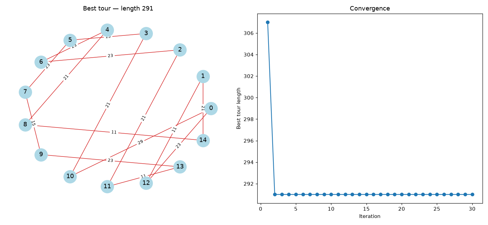

# Traveling Salesman with Ant Colony Optimization

[](https://github.com/BernardoFerrazG/TSP_ant_colony/actions/workflows/ci.yml)

An implementation of **Ant System**, the original Ant Colony Optimization (ACO) metaheuristic, for the symmetric **Traveling Salesman Problem**. On the bundled 15-city instance it reaches the **proven optimum (291)**, which the test suite verifies with an exact Held-Karp solver.



## How it works

Every iteration, a colony of ants builds complete tours:

1. **Tour construction.** From city `i`, an ant moves to an unvisited city `j` with probability proportional to `τ(i,j)^α · η(i,j)^β`. Here `τ` is the pheromone on edge `(i, j)` and `η = 1/d(i,j)` is its *visibility*.
2. **Evaporation.** All pheromone decays: `τ ← (1 − ρ) · τ`.
3. **Deposit.** Each ant adds `Q / L` to every edge of its tour, where `L` is the tour length, so shorter tours reinforce their edges more.

Over the iterations, pheromone concentrates on the edges of good tours. That is positive feedback, balanced by evaporation so the colony doesn't lock into the first tour it finds.

| Parameter | Meaning | Default |
| --- | --- | --- |
| `--alpha` | Weight of pheromone | 1 |
| `--beta` | Weight of visibility (greediness) | 5 |
| `--rho` | Evaporation rate | 0.5 |
| `--ants` | Ants per iteration | 15 |
| `--iterations` | Iterations | 30 |

Cost per iteration: `O(m · n²)` for `m` ants and `n` cities.

## Usage

```bash
pip install -r requirements.txt
python tsp_aco.py                        # default parameters, opens the plot
python tsp_aco.py --seed 0 --no-plot     # reproducible, text only
python tsp_aco.py --alpha 2 --beta 6 --rho 0.01
python tsp_aco.py --compare --seed 0     # compare the three preset parameter sets
python tsp_aco.py --save result.png      # write the plot to a file
```

The instance is a whitespace-separated distance matrix in [`distances.txt`](distances.txt); pass another with `-m`.

Parameter comparison (`--compare --seed 0`):

```
preset             alpha  beta    rho  best length
balanced               1     5    0.5          291
slow-evaporation       2     6   0.01          291
pheromone-heavy        5     5    0.1          307
```

With a very high `α` (pheromone-heavy), the colony converges early on a sub-optimal tour. That is the classic exploitation-vs-exploration trade-off.

## Tests

```bash
pip install pytest
pytest
```

The suite includes an exact **Held-Karp** dynamic-programming solver, used as a reference:

- confirms 291 is the optimum of the bundled instance, and that ACO with default parameters stays within 5% of it;
- checks that ACO finds the exact optimum on random 8-city Euclidean instances;
- checks that tours are valid permutations, the best-so-far history never increases, and runs are reproducible with a seed.

CI runs it on every push.

## Changes from the original version

- Pheromone is now updated **once per iteration** (classic Ant System), instead of after each ant. Evaporation also used to be applied twice to every matrix entry.
- Probabilities are vectorised with NumPy, and random seeds make runs reproducible.
- Parameters are exposed on the command line, and a convergence plot was added.
